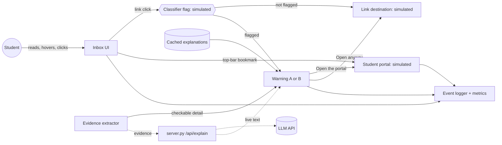

# VerifyFirst

**README prose word count: about 1093** (code, commands, file trees and the diagram are not counted)

VerifyFirst is a research prototype: a simulated university inbox that tests whether an AI warning that names one checkable detail leads students to verify account-suspension emails independently, compared with a generic warning. It builds on my Assignment 1 literature review.

- **Report:** see the submitted project report (Assignment 2).
- **Submitted version:** release `v1.0`, tagged in this repository.

## Project status

| Part | Status |
| --- | --- |
| Simulated inbox: 8 emails, 6 scored (3 phishing, 3 genuine) | Implemented |
| Condition A: generic warning at link click | Implemented |
| Condition B: warning with checkable detail, explanation, confidence, portal suggestion and "Why was this flagged?" | Implemented |
| Evidence extractor (link domain, sender domain, urgent wording, sign-in requests) | Implemented, unit-tested |
| Phishing classifier | **Simulated**: flags are scripted, with one deliberate false alarm (G2) and one deliberate miss (P3) |
| Explanation text (cached) | Implemented: generated with an LLM from the evidence, checked against the success criteria, then frozen so every participant sees the same text |
| Live explanation generation (`server/server.py`) | Implemented; tested against a mock API only, **not yet tested with a real API key** |
| Student portal (the independent check) | **Simulated** |
| Link destinations | **Simulated**: no page loads and nothing typed is collected |
| Event log, outcome measures, JSON/CSV export | Implemented, unit-tested |
| Study with participants | **Planned**, not yet run |
| Real classifier, mail-client add-in, randomised email order | **Planned** |

The university, its domain (`northvale.ac.uk`) and every email are fictional, so the prototype never imitates a real institution.

## Run it

No installation is needed for the study itself.

```bash
# Option 1: open the file directly
open app/index.html            # or double-click it

# Option 2: serve it (needed only for live explanations)
python3 server/server.py       # then visit http://localhost:8000
```

Useful URL parameters: `?condition=explained` or `?condition=generic`, and `?pid=P07`.

On the start screen the researcher chooses a condition, or "Auto", which alternates A and B between sessions. After **Finish**, the participant sees a debrief and the researcher panel offers JSON and CSV downloads. Sessions are also kept in the browser's local storage on that machine.

### Live explanations (optional, bring your own key)

Cached explanations are the default. To generate explanations live, supply your own API key for the LLM provider. The key is read by the server only and is never sent to the browser.

```bash
cp .env.example .env           # .env is in .gitignore: never commit a key
# edit .env: ANTHROPIC_API_KEY=your-key   (optional: VERIFYFIRST_MODEL=...)
python3 server/server.py
```

Then choose "Live LLM" on the start screen. If a request fails, or its text fails a success criterion, the app falls back to the cached text and logs which source was used and why.

## Tests

```bash
npm test                                  # all 18 unit tests (13 JavaScript + 5 Python)
node --test                               # extractor, success criteria, scenario set, outcome measures
python3 -m unittest discover tests        # server: prompt, output checks, mock API call
npm install && npx playwright install chromium
npm run walkthrough                       # scripted end-to-end run + screenshots + storyboards
```

## Technology stack

| Technology | What it does | Why |
| --- | --- | --- |
| HTML, CSS, plain JavaScript | The whole study interface | No build step, so it runs from a file on any lab machine |
| Python 3 standard library | Optional server and `/api/explain` | Keeps the API key off the browser; no packages to install |
| An LLM, through an LLM API | Turns the extractor's evidence into explanation text. The cached set was generated offline; `server.py` generates text live | The prompt (`prompts/explain_prompt.md`) is a six-part task specification. `app/js/criteria.js` checks every explanation against its success criteria |
| Node test runner, Python `unittest`, Playwright | Unit tests and the scripted walkthrough | Repeatable checks of the logic and the interaction |

Still undecided:

- Whether the study uses cached or live explanations. It currently uses cached text for experimental control.
- Which live model to use. The default is a small, fast model; it is set with `VERIFYFIRST_MODEL`.
- What would replace the scripted flags in a real deployment (for example an APOLLO-style LLM classifier).

## Repository layout

```text
app/                 the prototype (open index.html)
  js/data.js         scenario emails, scripted flags, cached explanations, portal content
  js/extractor.js    evidence extractor
  js/criteria.js     success criteria checked on every explanation
  js/logger.js       event log and outcome measures
  js/app.js          interface and study flow
server/server.py     optional server for live explanations
prompts/             prompt used to generate explanations
tests/               unit tests (JavaScript and Python)
scripts/             walkthrough, screenshots and storyboards
docs/                system diagram, screenshots, storyboards
```

## System diagram



A larger version is in `docs/system-diagram.png`.

## Development record

The commit history shows the order of the work. These are the significant decisions and changes.

| Stage | What changed and why |
| --- | --- |
| Assignment 1 | Literature review led to the question and design: simulated inbox, matched genuine and fake notices, deliberately wrong AI flags, four outcome measures. |
| Scenario set | Six scored emails and two fillers. I added a missed phishing email (P3) as well as a false alarm (G2), so over-reliance can show up in both directions. |
| Warning timing | The warning appears when a link is clicked, after the email has been read, instead of as a banner when it opens (Greco et al., 2025). It interrupts the action (Egelman, Cranor and Hong, 2008). |
| Explanation design | The Assignment 1 plan only said "highlight a checkable detail". I added counter-evidence and confidence, so that for the false alarm the warning shows that the link is a university address instead of pushing the student to reject a genuine notice. |
| Cached explanations | The text is frozen rather than generated live, so every participant reads the same words. Live generation is kept as an option. |
| Safety | No link loads a page, no screen asks for a password, and the institution is fictional. |
| Prompt as a specification | After the Week 3 lectures I rewrote the prompt as a six-part task specification (task, audience, constraints, example, success criteria, output format). I wrote criteria C1–C7 first; six of them are checked in code. Live text that fails a check is replaced by the reviewed cached text. A test confirms that reusing one email's explanation for another fails the domain criterion (C3). |
| Fault 1: explanation vs evidence | A unit test found that the cached G2 explanation said the email asked the student to sign in, but the extractor found no sign-in request in the email. I revised the email text so the scenario, evidence and explanation agree. |
| Fault 2: results panel | Storyboard 3 showed "False alarm handled: No" for a session that never opened that email. Unopened emails now count as "not opened", and a test covers it. |
| Test status | The submitted version passes 18 automated tests (13 JavaScript, 5 Python) and the end-to-end walkthrough. The output is in `docs/test-results.md`. |
| Pilot (3 classmates: P01 in A, P02 and P03 in B) | No phishing link was clicked, 2 participants checked the portal, 2 handled the MFA false alarm correctly and 1 reported it as phishing. P01 (A) noticed the risk but not why. P02 used the portal to check the MFA email instead of accepting the warning. P02 and P03 found the explanations long, and P03 asked for a clearer line between a risk warning and a definite judgement. |
| Changes after the pilot | Explanations shortened. The "Verify it yourself" step moved directly under the evidence and made more prominent ("Check in the student portal"). Warnings relabelled "AI risk warning · not a verdict", with confidence described as a risk estimate. The generic warning is unchanged because it is the control condition. All 18 tests and the walkthrough pass after the changes (`docs/test-results.md`). |

## AI assistance

TODO (write before submitting).

## Additional files

There is no ZIP file. Screenshots are in `docs/screens/`, the storyboards in `docs/storyboards/` and the system diagram in `docs/`; all can be regenerated with `npm run walkthrough`. The latest test output is in `docs/test-results.md` (`scripts/record_test_results.sh`).
